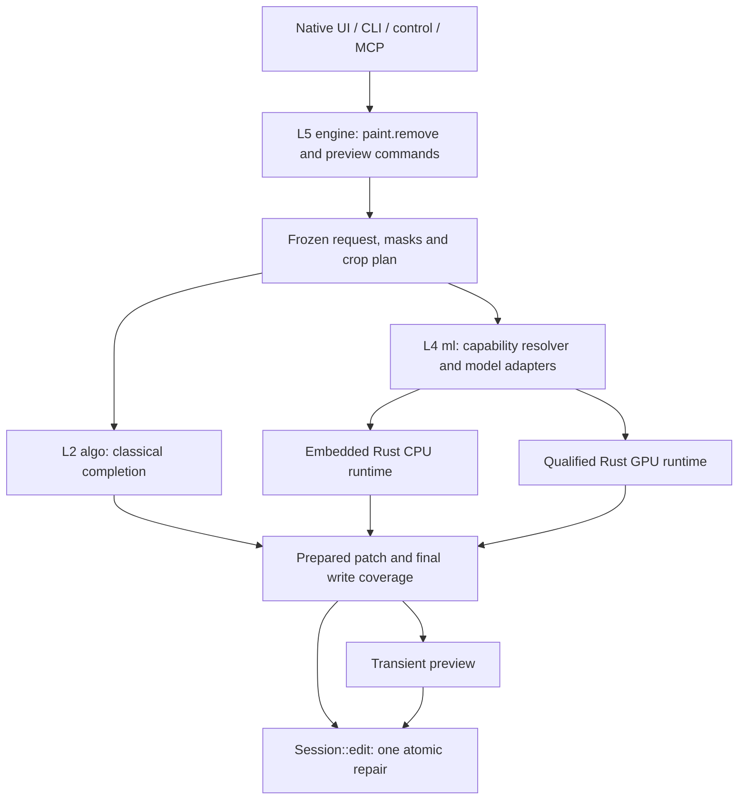

# Smart content removal in PhotoCraft

**Status:** proposed design, revision 3, for review. Revision 2 addressed the verified Opus 5.5 findings on revision 1; revision 3 records the first model pilot and expands candidate selection. These revisions have not received a second independent review. Application implementation remains unqualified.

**Date:** 2026-10-26. **Source baseline:** `59cb4c49bd236df04d8e37d4764253f29ca6600a`.

## 1. Product decision

Extend the existing Remove tool so a user can paint over an unwanted object and reconstruct its background entirely inside PhotoCraft. Keep the native brush interaction, queued strokes, layer targeting and undo. Run inference locally through Rust libraries; require no model server, Python installation, external editor or account. Download optional model data through PhotoCraft, then work offline.

Build one repair pipeline with interchangeable implementations. Retain classical completion as the available baseline, evaluate an embedded LaMa adapter, and trial Moebius as the first new quality candidate. Investigate OSOR-SDXL separately for removing associated shadows and reflections. Choose the default AI model only after comparison on the same images and masks, native runtime validation and asset-license review.

The intended result is a useful integrated removal tool. This design does not assert Photoshop parity or establish that a paper's benchmark results transfer to PhotoCraft.

## 2. Scope and boundaries

The first delivery includes the existing Remove brush, local AI direct apply on qualified desktop configurations, verified install-from-file through native UI, inspectable capability/fallback information and one-step undo. The original layer can remain unchanged by choosing Create a new layer. Prepared-result preview, Protect, effect removal and managed network downloads are later stages; they do not block testing or delivering a useful direct-apply AI brush.

Prompted image generation, Generative Fill/Expand, automatic discovery of every person or wire, a general node editor, arbitrary model plug-ins and cloud providers are outside this delivery. Automatic subject detection is an independent feature; the removal API accepts the user's brush mask without requiring segmentation.

No C++ inference backend or new workspace `unsafe` exception is introduced. `stable-diffusion.cpp` and ONNX Runtime can be embedded, but do not fit the unchanged Rust-first architecture as directly as the proposed Rust implementations. Browser builds retain Classical Remove; learned browser inference stays unavailable until separately qualified for operators, memory and responsive execution.

## 3. What already exists

| Current implementation | Design consequence |
| --- | --- |
| [`paint.remove`](../../../crates/engine/src/retouch_cmds.rs) and [`retouch_cmds/remove.rs`](../../../crates/engine/src/retouch_cmds/remove.rs) already implement brush/loop removal, combined strokes, Sample All Layers and new-layer output. | Extend this command and share its preparation code. Do not add a competing toolbar tool. |
| [`jobs.rs`](../../../crates/engine/src/jobs.rs) runs snapshot-based work and commits through `Session::edit` as one undo step. Cancellation immediately unlocks the document, although a worker may still be draining. | Preserve the commit boundary; keep inference resources reserved until actual worker exit. |
| [`retouch_ui.rs`](../../../crates/ui-egui/src/retouch_ui.rs) provides pending-stroke tint, Enter/apply and Esc/cancel. | Keep these interactions. Add optional result preview after processing. |
| [`state.rs`](../../../crates/ui-egui/src/state.rs) stores serde-defaulted Remove options; [`prefs.rs`](../../../crates/engine/src/prefs.rs) persists tool options. | Migrate options with explicit defaults rather than changing old scripts or profiles silently. |
| Pending UI strokes currently retain point lists, but commit reads current brush settings. The target key omits source revision and selection identity. | Capture each stroke's effective brush width and freeze the operation context. The mask shown must be the mask submitted. |
| The classical hole currently treats positive selection coverage as Boolean. Float colour clamping also removes negative values inside repaired pixels. | Fractional write coverage is new work. Classical fallback is not evidence of complete HDR fidelity. |
| [`xtask/src/layers.rs`](../../../xtask/src/layers.rs) already reserves `ml` at L4, but no model runtime/store exists in this source baseline. | Implement that seam at L4; do not describe the architecture document's ML sketch as shipped code. |

## 4. User interaction

Keep Remove in its existing J-tool flyout. Retain brush size, Sample All Layers, Create a new layer and Remove after each stroke. Add a compact Method choice of **Auto**, **Classical** and **AI**. The later preview stage adds **Preview result**. Model names, devices, sampling steps and precision belong in model settings and diagnostics rather than the ordinary options bar.

- Classical uses the existing algorithm and write semantics, as does Auto when it selects Classical. A request without `method` also preserves that same legacy path. New fractional coverage or protection must never silently alter those requests.
- Auto uses the user's installed, qualified recommended model when its capabilities match the request. Otherwise it uses Classical and reports the effective method and reason. It never downloads a model on a brush stroke.
- AI requires the selected compatible installed model. Missing assets, unsupported targets and inference failures produce an actionable error, not an undisclosed method change.

Both existing and new profiles default to Classical in the first delivery; Auto and AI are explicit choices. This needs no ambiguous old/new serde default migration. A later default change requires its own versioned preference migration and qualification. Preserve the current defaults of Create a new layer off and Remove after each stroke on. In the later preview stage, Preview result starts off; enable it automatically when the user opts into effect removal.

When Remove after each stroke is off, Enter or the current apply button submits the accumulated strokes. With preview off, processing applies one repair. With preview on, processing produces a staged result; a subsequent Enter/Apply commits it and Esc/Cancel discards it. Enter while processing cannot queue a duplicate operation. A press used to submit strokes cannot also accept the resulting preview.

With Remove after each stroke on, releasing a stroke starts processing. Preview on stops at the staged result. Preview off applies on completion. Neither mode runs inference on every pointer move. During processing, disable new Remove gestures before pointer capture and show the busy state; do not collect a stroke and discard it through a job-conflict error. While a preview is staged, require Apply or Cancel before starting another stroke. Explicit Retry remains available only for a failed operation with a valid frozen source.

Esc drops queued strokes, cancels running work, or discards a staged result according to the current state. A failed request retains its frozen mask for an explicit Retry only while its source is still valid. Do not automatically retry inference, switch models or download assets. Tool, document, selection or destination changes clear an unsubmitted or staged interactive operation with a short status message.

The first model manager offers Install from file and Remove, expected artifact identity, license/source information and readiness. A later app-managed downloader adds Install and Cancel download. Normal flow says, for example, "AI model not installed" or "Using Classical for this channel." Tensor diagnostics and full filesystem paths stay in diagnostics. All new text is localized and all widgets/overlays use theme tokens.

Effect removal is a later capability in this same tool. Its predicted expanded region is visible before Apply. A Protect brush excludes pixels from the final repair. Protection means "do not change these pixels"; it does not mean "do not use them as context."

## 5. Architecture and ownership



| Owner | Responsibility |
| --- | --- |
| `photocraft-algo`, L2 | Existing classical completion and reusable mask/patch operations. It never depends on `ml`. |
| New `photocraft-ml`, L4 | Typed float image/mask input, capabilities, model manifest/store, adapters, inference admission and errors. No egui, document mutation or UI state. |
| `photocraft-engine`, L5 | Resolve the destination and source, validate params, build masks/crops, perform CMS conversion, select a backend, own prepared results and commit/history/provenance. |
| `photocraft-ui-egui`, L6 | Gestures, options, native progress and preview rendering through engine-owned state. |
| Desktop/CLI app services | Resolve managed model directories and permitted download/storage services; configure available compute backends. |
| `photocraft-automation`, L6 | Enforce model-management capabilities and expose safe command/render inspection. |

Inject an `Arc`-owned removal service into the engine rather than a global mutable model singleton or UI-only worker. Its adapter contract describes accepted shape, model RGB encoding, supported execution backends, memory estimate, cancellation boundaries and whether an effect mask can be returned. Its input/output use bounded f32 buffers or typed surfaces, never a public u8-only pixel API. The engine owns `JobCtx`; adapt its progress/cancellation interface without creating an upward dependency from L4 to L5.

Use `tract` as the first embedded CPU candidate for the LaMa baseline. Evaluate Burn/wgpu for a Moebius port. These are candidate implementations, not a promise that existing ONNX import or a generic diffusion pipeline supports every required operator. Default builds compile without learned weights. Cargo features isolate optional implementations; an unavailable feature is reported in capabilities.

The app's renderer currently uses wgpu 30. Do not assume a chosen Burn release can share its device or buffer types. First prove dependency compatibility and safe scheduling. A separate inference device is acceptable if measured memory and responsiveness meet the budgets. Respect the app's GPU choice and safe-GPU recovery; never initialize ML during graphics startup or silently retry a failed device.

## 6. Model strategy and reuse

| Candidate | Role | Requirement before use |
| --- | --- | --- |
| Existing classical completion | Always available baseline; legacy command compatibility. | Preserve existing tests and qualify any changed write coverage separately. |
| LaMa through Rust `tract` | Integration baseline using the adapter and installer ideas in PR #8231. | Real converted-model numerical/quality tests, CPU timings, memory limits and verified asset licenses. |
| Moebius | First new quality candidate for an efficient local repair model. | Port or validate export of its custom architecture, separate VAE and sampling loop; compare against the upstream implementation and baseline. |
| MI-GAN, exact older `migan.onnx` artifact | Small CPU candidate; distinct from its newer pipeline. | Native numerical agreement, removal quality and exact artifact/preprocessing qualification. Do not substitute pipeline versions by name. |
| OSOR-SDXL Phase II | Research challenger for effects beyond the painted object. | Implement its additional alpha output and inference semantics. Weight restrictions need a separate distribution decision before shipping under the current permissive-asset rules. |

The 2026-10-26 pilot completed fifty cases for Classical, native tract LaMa, Moebius through a PyTorch/Metal reference, MI-GAN v2 through ONNX Runtime, and native tract MI-GAN v1. Independent decoding verified all 250 strict-mask composites preserve source bytes outside the mask. LaMa and MI-GAN v1 each agreed with matching-artifact reference outputs within one decoded byte value on ten cases; that is a bounded output comparison, not universal tensor equality. MI-GAN v2 failed native typed optimization and left four thin-wire controls unchanged through its own mask blending. Its results cannot qualify v1 or vice versa.

This pilot contains thirty generated paired-removal scenes and twenty synthetic-hole controls from public-domain photographs. It does not meet the planned natural-photo category corpus or independent human acceptance gates. Moebius preserved useful scene structure in some examples but retained objects or smudges in others; neither pixel scores nor CPU speed select a quality winner. Its reference preprocessor accepts rectangular dimensions, but the tested custom attention block assumes a square token layout and failed an actual rectangular forward. Keep square model inputs until another path is qualified. Preserve this experiment and subsequent crop/mask/initialization variants separately from the frozen comparison.

Before a new Rust port, compare stronger released models on the same difficult cases. The current shortlist includes Apache-2.0 FLUX.2 klein base 4B with a masked inference path, newer Qwen-Image 2.1, and effect-aware specialists such as ObjectClear. Their exact masked-model combinations, weight terms, quality, memory and native implementations require separate qualification. Qwen-Image 2.1's research license and ObjectClear's noncommercial terms do not satisfy the current permissive-asset rule merely because weights are downloadable. The first baseline's successful forward is not a decision to ship it as the default. [FLUX.2 klein base 4B](https://huggingface.co/black-forest-labs/FLUX.2-klein-base-4B), [masked pipeline](https://github.com/huggingface/diffusers/blob/main/src/diffusers/pipelines/flux2/pipeline_flux2_klein_inpaint.py), [Qwen-Image 2.1](https://huggingface.co/Qwen/Qwen-Image-2.1), [ObjectClear](https://github.com/zjx0101/ObjectClear).

Moebius supplies a compact denoising model and released weights, with a separate VAE. Its reference configuration uses 512px images and custom blocks. Published quality and speed are the authors' benchmark results, not native PhotoCraft measurements. Start with bounded square context crops; do not assume arbitrary shape or resolution support. Its repository and hosted model metadata label licenses differently, so verify the exact model/VAE artifacts before publishing a download catalog entry. [Moebius source](https://github.com/hustvl/Moebius), [configuration](https://github.com/hustvl/Moebius/blob/main/config/model_cfg/moebius.yaml), [weights](https://huggingface.co/hustvl/Moebius).

OSOR-SDXL predicts an additional blending alpha and can remove associated effects outside a conservative object mask. Its checkpoint is not an ordinary drop-in LoRA. The SDXL family uses Open RAIL terms; the FLUX family uses a noncommercial license. Keep both out of the default distribution until the applicable asset policy is resolved. Ordinary whole-image paste-back would reintroduce outside-mask effects, while accepting the whole decoded image could change unrelated pixels. [OSOR source](https://github.com/Zhouqm-Git/osor), [checkpoint contract and licenses](https://huggingface.co/QinmingZhou/OSOR).

Reuse small, reviewed pieces rather than merge overlapping ML stacks:

- [PR #8104](https://github.com/storytold/photocraft/pull/8104), inspected head `19625ccdc02e7571625db479b61d186f7a0d5251`: brush-mask and context-crop ideas, background/progress UI and model management. Reuse existing main-branch equivalents first. Do not adopt its RGB clamping as a generic HDR bridge or require its ONNX Runtime backend.
- [PR #8231](https://github.com/storytold/photocraft/pull/8231), inspected head `09aad5020ab5d9b2276140c8ae5e9cebfb4d4ef8`: embedded LaMa adapter, checked installation, missing-model handling, undo and unsupported-HDR behavior. Do not require subject detection to use the brush or inherit a claim of interruptible inference.
- [PR #6054](https://github.com/storytold/photocraft/pull/6054), inspected head `6e0335cb1df827e05393b2055c310a61e339ecb5`: feathering, surrounding-colour matching and output-layer ideas, adapted to f32/CMS. Its HTTP backends and server settings are outside the design.

Each reuse retains license/attribution obligations and is reviewed against the actual destination code. The PRs have overlapping command ids and incompatible `crates/ml` designs. Their descriptions, CI and supplied examples do not qualify the combined implementation.

## 7. Frozen request, masks and crop planning

Freeze document id, source snapshot/revision, resolved layer and channel restriction, target kind, selection identity, each stroke's brush geometry, method/model, seed, sampling mode, output mode and preview/effect options before starting work. Bind profile/format identity and any source composite to that snapshot. Never re-read current toolbar values on a worker or at commit time.

Keep distinct masks for the painted object, inference hole, fractional final write coverage, explicit protection and optional predicted effects. Closing loops and the current two-pixel growth belong to hole construction. After growth, define the learned inference hole as `H = grown_object_mask AND (selection_coverage > 0) AND NOT protection`. Unselected/protected pixels must be removed from the hole as well as excluded from final writes, so the model actually sees them as known context.

For new requests using the smart pipeline, define final coverage in document coordinates:

```text
R = reconstructed object coverage, including the requested edge growth
E = accepted predicted effect coverage, or zero when effect removal is off
S = original selection coverage, or one when no selection exists
P = hard protection mask, one wherever the user protected a pixel
W = clamp(max(R, E), 0, 1) * S * (1 - P)
```

Learned and explicitly opted-in future preview requests retain fractional selection coverage at write time. Treat positive Protect-brush coverage as hard protection so a protected pixel remains exact. Bound effect expansion by the inference crop, the selection and protection. Never grow `W` after these restrictions. Feather inside the allowed region; do not blur a finished mask back across protected or zero-selection pixels. Classical, Auto's Classical fallback and requests without `method` all retain the same existing Boolean-selection behavior until a separately tested migration.

Retain the current 16,777,216-pixel stroke bounding-box ceiling and 512px maximum context margin. Also validate the expanded sampling rectangle and aggregate stroke/point counts before allocation. Initial smart-request admission limits are 256 strokes, 65,536 total points and at most 16,777,216 context pixels per operation. Checked arithmetic and backend working-set estimates may reject a request below these ceilings. Existing documented classical behavior is not expanded by these limits.

Plan connected holes and their context before inference. Merge nearby holes so they see one another; process truly separate context groups serially from the same frozen source. Never sample a provisional output from another group. If two planned write regions overlap, merge the groups or reject the plan rather than blend independently generated overlaps.

Preserve aspect ratio by padding to the adapter's supported shape. Inference uses the bounded context crop, not a screenshot and not the full document. Map generated patches back to native document coordinates. A 512px model must not resize the document or silently shrink a difficult removal without reporting the effective inference scale. Qualify structure/detail preservation across crop scales. Arbitrary overlapping tile synthesis, super-resolution and guessed texture restoration are not assumed solutions for large holes; unsupported requests use explicit fallback/error rules.

## 8. Colour, depth, alpha and output

The first learned adapters support full-colour pixel targets in U8/U16 documents with a qualified sRGB profile and opaque sampled context. Profile eligibility is a stable capability decision, not a per-image clipping threshold: wide-gamut and other profiles use Classical in Auto until their conversion policy is separately qualified. Masks, alpha/spot channels, Quick Mask, isolated colour channels, non-RGB modes, F32/HDR and unsupported transparency also use Classical in Auto; explicit AI returns an unsupported-target/format error. Preserve existing Classical behavior without claiming new HDR fidelity. Reject nonfinite or out-of-contract input explicitly rather than silently clamping it.

Resolve the document ICC profile and use `photocraft_cms::transform::cached` with precise float conversion to the adapter's declared profile/transfer function. Reject a missing required transform or out-of-range/nonfinite model input. Never assume document RGB means sRGB. A model's f32 tensors do not make it HDR-aware.

Transform only the generated patch back into the document's original mode, depth and profile. Preserve native stored samples exactly wherever `W == 0`, including original alpha, auxiliary channels and untouched tiles. Perform final colour blending with the existing compositing conventions. Do not round-trip the whole crop/layer through an RGB byte buffer, clamp the whole document, or reinterpret a model's effect alpha as document transparency.

For current-layer output, blend colour with the existing premultiplied-alpha conventions. When transparency is unlocked, `A_out = lerp(A_original, A_repaired, W)`; keep original alpha only under the transparency lock and skip locked fully transparent pixels. An empty raster layer with Sample All Layers on must acquire visible repaired pixels, not retain alpha zero. The first opaque-context adapter returns repaired alpha one. Selection/protection must be applied exactly once.

For new-layer output, construct the actual native raster layer and placement before rendering a preview; its coverage alpha represents `W`. Never claim that current-layer and new-layer output are equivalent under arbitrary opacity, fill, blending, masks or effects. The first learned path qualifies simple Normal raster destinations at full opacity/fill with no masks/effects or clipping-chain involvement, including compatible ancestors. Auto uses Classical for other layer contexts; explicit AI reports the unsupported context. In particular, inserting a layer above a clipping base must not retarget its following clipped layers. Broader support requires an output-specific candidate document and proof that unrelated layers/composite pixels remain unchanged.

Alpha/pixel locks, clipping/parent semantics and explicit channel restrictions are checked through the existing engine admission/commit path. An all-transparent current target with Sample All Layers off remains a no-op with no history. No new document-model fields are needed: committed output is ordinary raster data. Saving/reopening and undo/redo require no model download or rerun.

## 9. Prepared preview and atomic apply

A prepared result contains a fully constructed candidate `Arc<Document>` with copy-on-write tiles, the chosen layer/output arrangement, `W`/crop provenance, source/target identity, request generation and canonical model/backend/asset parameters. Preview and authorized `doc.render` render that candidate document itself. Apply installs that exact candidate through the existing `Session::edit`/`edit_job` pattern; it does not blend again or rerun inference. Count newly retained tiles and masks in memory admission: copying the document metadata is cheap, but modified pixel tiles are not free.

Prepared results are transient engine state, referenced by an opaque session-local handle. Keep at most one retained result per document and two per Session, with a combined 256 MiB incremental retained-tile/mask budget, further limited by the user's memory budget. This is an admission limit, not a promise that a maximum 16M-pixel repair fits; reject an oversized preview before materializing its candidate. Additional in-flight/resident-model memory is separately admitted. Expire unused results after ten minutes using monotonic elapsed time; an expired result returns an explicit status. Creating another preview for the same document replaces its old generation. Do not serialize handles/tensors into preferences, actions, recovery files or `.pcraft`.

Apply rechecks authorization, active/bound document and target, snapshot/revision, selection and channel restriction, format/profile, locks and request generation. A changed source, target or settings invalidates the preview. Switching away and back cannot resurrect an invalidated interactive result. A stale/foreign/expired handle returns an error with no mutation and no automatic regeneration. An already consumed handle reports that it was applied; it never creates a second layer/history step.

Commit the shown patch through exactly one `Session::edit`. Cancel, failure, no-op and preview creation create no history. Apply marks dirty/damage only for the committed repair. Undo and redo restore stored document data, not fresh inference. The direct non-preview `paint.remove` path retains current background-job behavior: completion is bound to its original document/target even if the user views a different tab; it never retargets the current tab.

The existing paint `LiveCommit` is a useful identity-checking precedent, not a prepared-Remove API. New preview preparation must explicitly carry source identity: `jobs::run(lock_document=false)` does not supply document fencing. Preview preparation can release its brief source edit lock after publishing a validated staged result; retained previews never hold an editing lock for the user's review period. Any later edit invalidates them.

## 10. Jobs, cancellation and resource limits

| State | Document effect | Cancellation/completion |
| --- | --- | --- |
| Collecting strokes | None | Esc drops the queue. |
| Planning / waiting for resources / loading / inference / blending | None | Esc cancels the operation and invalidates its generation. |
| Ready for preview | None | Apply commits once; Esc discards. |
| Applied | One edit/history step | Undo restores it. |
| Failed / cancelled / stale | None | Explicit retry needs valid original inputs or a new request. |

Use a process-wide admission manager, initially allowing one active learned inference and one loaded model family. Bound the waiting queue to one pending learned request per Session; further requests return busy. A pending request retains only validated geometry/source references, not another full tensor working set. Prepare heavyweight buffers only after admission. Switching model families waits for current use to end, then evicts the previous idle model.

A permit covers model loading, tensors, adapter scratch buffers and queued device work. Hold it until execution and resource cleanup actually complete, even after `cancel_job` removes the logical job and unlocks its document. Check cancellation before/after loading, each interruptible inference step and before publishing/committing. A tract call may be noninterruptible: report that the request was cancelled and discard its eventual output, while diagnostics show the backend still draining. Do not equate logical cancellation with immediate GPU/CPU termination.

Honor the existing performance-memory preference when admitting model working sets, including prepared results and estimates for device allocations. If the backend cannot estimate a bounded working set, it is not qualified as an Auto backend. Return busy or memory-unavailable before large allocation. AI reports errors; Auto may choose Classical during preflight with a reason, but never retries another backend after a failed inference.

Propagate existing worker authorization and document-path scopes. A worker never mutates the live Session. Catch escaped Rust panics through the shell/job safety net, use checked sizes, and report corrupt/unsupported tensors, NaN output, disk-full and device errors. Rust panic handling cannot contain every graphics-driver failure; qualify each supported backend and keep ML disabled after a device failure until an explicit retry or restart. Shutdown may discard cancelled worker output, but must not wait for noninterruptible inference on the UI thread.

## 11. Commands, actions and automation

Names below are proposed additions; check the current command/menu catalog when implementing. Every command needs parameter docs, enablement, validation and graceful-failure tests. All clients dispatch these commands rather than invoking a UI-only inference API.

| Command | Contract |
| --- | --- |
| `paint.remove` | Existing direct apply. Add `method`, optional installed `modelId`, `seed`, `removeEffects` and `strokeSpecs`; no `method` preserves legacy behavior. Effect removal requires the preview lifecycle. |
| `remove.preview` | Later stage: same repair inputs; computes and retains a candidate document without editing. Returns a prepared handle plus effective method/model, crop/scale, bounds, fallback reason and ready state. Background form uses the existing job protocol. |
| `paint.remove.apply` | Accept only the prepared handle. Validate and consume the exact shown result. No changed settings, arbitrary destination or recompute option. |
| `remove.discard` | Later stage: discard a handle idempotently, release retained candidate data and invalidate its generation. |
| `remove.previewInfo` | Later stage: inspect handle readiness, expiry, bound source, provenance and invalidation reason without exposing raw tensor buffers. |
| `remove.capabilities` | Report available compiled adapters, installed/qualified models, compatibility with the current request and backend readiness. |
| `ai.models.list`, `ai.models.import`, `ai.models.remove` | Manage catalog model ids. Import uses explicit file capability/native chooser, verified hashes and storage authorization. A later `ai.models.install` delegates downloads to app services. |

Retain `points` and uniform-brush `strokes` input. Add mutually exclusive `strokeSpecs` for mixed-width gestures, each containing points, frozen brush geometry and `operation: remove|protect`. Do not accept several competing input forms in one request. Freeze non-brush operation settings on the first queued stroke; changing sampling/method/output settings invalidates that queue. Brush-size changes affect only subsequent stroke specs.

Reject unknown methods/models, wrong types, nonfinite/out-of-range numbers, unsupported effect requests and oversized geometry before pixel allocation. Explicit model ids must be compatible with the requested method. Resolve a default seed at submission and retain it; preserve the legacy seed `0x0052_e30e` for old requests. Determinism is qualified per adapter/device/precision; do not promise bitwise cross-device ML equality.

Preview/import/install/remove-model/discard/query commands are not recorded as document actions. Non-editing removal commands deliberately avoid the `paint.` prefix so they do not enter the current prefix-based Fade path. Keep `paint.remove.apply` journaled and subject to the running-job admission checks; add an explicit recorded-step hook returning canonical command id and parameters, so the journal/actions store `paint.remove` with resolved method/model/asset revision, seed, strokes and output choices rather than a dead handle. The existing `layerComp.apply` hook rewrites parameters only; rewriting the command id is new work. Action replay requires the recorded model assets and fails if missing, with no undisclosed substitution. Redo uses saved pixels. Effect-aware playback stops with `preview_required`; automatic effect-aware batch replay is deferred, and no caller-supplied `accepted` flag bypasses acceptance for a new source.

Expose the removal lifecycle, stroke count, effective method/model, current job and availability in `ui.inspect`. Add explicit Remove settings to `ui.set`'s allowlist; serde fields alone are insufficient. For headless inspection, extend authorized `doc.render` to render a specified prepared result for its bound source without mutating/saving the document. UI screenshots render the same overlay. Neither path returns raw model memory or changes the write grant for normal document export.

`paint.remove` accepts installed manifest ids, never arbitrary model paths, URLs or executable formats. Existing automation policy does not automatically protect new filesystem-bearing commands: explicitly deny import/install/remove through ungranted sessions before disk/network access. In addition, model management is refused inside action playback, scripts and droplets, even in a trusted desktop Session; being nonjournaled alone is insufficient. Only an explicit native model-manager invocation or a narrowly granted direct management capability can manage allowlisted ids. Untrusted document input cannot trigger downloads, rewrite model directories or accept a license. All control/MCP paths enforce the same prepared-handle and target checks in the engine, regardless of modal UI state.

## 12. Model storage, distribution and platform behavior

Each catalog entry pins all required artifacts and preprocessing/sampler settings: upstream revision, content hash, expected/max bytes, safe tensor format, model/VAE identity, input shape, runtime compatibility, license/provenance, memory estimate and qualification status. A release cannot advertise Ready before its exact catalog entry and packaged backend pass qualification. Do not invent hashes or infer weight redistribution rights from a code license.

Use an app-managed data directory, separate from roaming preferences. Add a desktop `model_dir` service: platform local app-data conventions in normal mode, `<PHOTOCRAFT_CONFIG_DIR>/models` for an explicit override, and `<exe>/PhotoCraftData/models` in portable mode. A read-only portable directory reports installation unavailable; an alternate persistent location requires an explicit user choice. Store ids/preferences, not weights, in settings. Native builds with weights preprovisioned use the same verification path.

The first delivery imports a user-selected catalog artifact through a file capability, verifies every component and atomically publishes a complete model family. A later downloader belongs in desktop app services, not the engine/algorithm layer; its direct HTTP/TLS dependency and packaging/features must be explicitly reviewed. HTTP clients already appear transitively in `Cargo.lock`, which does not establish an existing managed-model download service. Download bounded HTTPS streams to task-owned same-filesystem partial files, verify pinned bytes/hashes across redirects, and never replace a valid family on interruption, corruption or full disk. Serialize install/remove for each model and retain in-use leases until the actual worker returns. Use pinned allowlisted sources and a generic `Photocraft-dev` User-Agent. Do not run downloaded Python, pickle loaders or shell conversion commands inside the app.

Convert/repackage upstream training checkpoints into supported non-executable assets during a reproducible maintainer preparation step, outside the runtime. That step records source/converted hashes, tensor layout, conversion tooling revision, numerical comparison and licenses. Raw checkpoints, weights and generated comparison outputs do not belong in this repository. Runtime installation requires no Python or converter.

| Platform | First qualified behavior |
| --- | --- |
| macOS / Windows / Linux desktop | Classical always; embedded CPU/GPU AI only for adapters/devices that pass their real-model matrix. Apple Silicon, NVIDIA, AMD and Intel results are separate evidence. |
| Headless CLI | Same engine/model capability contract; synchronous completion is supported without a GUI/model server. Explicit errors for unavailable adapters. |
| Browser | Compile and retain Classical Remove. Report AI unavailable until a Rust worker execution path, compute backend and model persistence are qualified. Existing inline wasm jobs do not prove responsiveness. |

Do not embed weights in native executables or wasm. Preserve the browser's 24 MiB host-file limit and existing compressed app-part packaging. App wasm chunking does not establish a model-download/storage mechanism. A later web implementation must handle browser quota, eviction, cancellation and GPU absence independently; it must not freeze the main thread for inference.

## 13. Validation and acceptance

### Behavioral contract tests

Write meaningful regressions before production changes for the following behaviors:

1. Old `paint.remove` requests retain their algorithm, defaults, channel behavior, new-layer placement and single undo step.
2. Frozen mixed-width masks match their displayed footprints; queued settings/target/selection changes cannot redirect a request.
3. Preview creates no edit, dirty flag or history; Apply equals the displayed patch, commits once and cannot accept foreign, stale, expired or consumed handles.
4. Direct background completion remains bound to the original document/layer/channel; preview acceptance rejects a changed target or revision.
5. `W == 0` samples and protected pixels remain byte-identical. Fractional selections are applied once, including new-layer output and undo/redo.
6. Cancellation at each stage prevents late publication/commit. A noninterruptible cancelled worker retains its permit until actual return, even though its logical job disappeared.
7. Missing/corrupt/wrong-shape models, unavailable devices, invalid params, NaN output and memory admission fail gracefully. Failed explicit AI never silently changes method.
8. Unsupported modes/depths/channels and transparency report compatibility accurately. No global ICC/depth/alpha conversion or hidden HDR clamping is introduced by the learned bridge.
9. Managed model ids cannot bypass automation grants; denied install/remove touches neither disk nor network. Interrupted/full-disk downloads preserve the previous valid install.
10. Applied pixels save/reopen and undo/redo without model access. Actions contain replayable canonical parameters rather than session handles.
11. Empty-layer Sample All Layers produces visible alpha when unlocked and preserves transparency-lock behavior. Current/new-layer previews render their actual output arrangements; opacity/fill/masks/effects/clipping contexts are rejected or independently qualified.
12. Protected pixels outside the inference hole remain available as known context. Gestures during processing/staged preview are rejected before capture without lost submitted strokes.
13. Action/script/droplet model-management requests are refused before side effects; non-editing queries do not alter Fade. Missing method/preferences retain the agreed first-delivery defaults and Classical semantics.
14. The new `photocraft-ml` feature matrix builds for wasm without inference. Shutdown with a cancelled noninterruptible worker keeps its permit until actual exit and never joins it on the UI thread.

Use test adapters for lifecycle/error contracts only. Passing stub tests does not qualify a model, native GPU backend or visual result. Add opt-in pinned real-model numerical comparisons against the upstream reference, including tensor layout, mask polarity, scaling, sampler settings and output tolerances. Normal tests perform no network downloads.

### Image-quality comparison

Freeze thirty public-domain/licensed test scenes and masks before model tuning: five each for smooth backgrounds, fine texture, straight/repeated structures, thin wires, people/objects with effects, and large irregular holes. Include incomplete masks and negative examples where an adjacent subject must survive. Evaluate the same crop policy and source masks for all applicable models; report effect-removal cases separately. Store image rights and pins in the corpus workflow, not personal-photo requests or copied evidence in this repository.

Compare existing Classical, embedded LaMa and Moebius. Add OSOR only in its research lane. The upstream reference implementation may be used to establish conversion/numerical oracles during research; it is not an application runtime dependency. Compare with Photoshop only when genuine Photoshop outputs for the same scene/mask are available, and keep that qualification separate.

Blindly score removal completeness, boundary artifacts, structural continuity and texture plausibility on a fixed 0–3 rubric. Record retained-object/shadow traces and unwanted changes outside `W` separately. A proposed AI default must have a higher mean score than Classical, at least 21/30 cases judged usable without a second repair, and no protected/outside-mask changes. Publish losses and per-category results as well as the aggregate. These are proposed product gates, not measured results or proof of Photoshop parity.

### Performance and native UI

Use 24–36 MP documents with small repairs, large masks and several disconnected holes. Measure cold-load and warm inference separately, including preprocessing/blending, peak process/device memory, UI frame latency and logical cancellation versus actual worker drain time. Record adapter, precision, image/mask size, crop scale, model hashes and build flags.

Initial targets, to be measured rather than claimed:

- No allocation proportional to the full document for a small repair; read source tiles/crops and cache by revision rather than scan the document every frame.
- Foreground input handling stays below 50 ms p95 during inference; cancellation is acknowledged within 100 ms. Drain latency is reported separately and is not promised to be under 100 ms.
- A qualified GPU Auto path completes a warm single 512px context repair within 2 s p95 on its named reference hardware. Cold load is reported separately. CPU inference that misses this target can remain an explicit AI choice with progress, rather than qualify as Auto.
- Resident and transient memory stay inside the admitted budget; cancellation/retry stress never accumulates active model families or unbounded draining workers.

Only promote these targets into enforced `perf/budgets.toml` entries after reference hardware and reproducible scenarios exist. Preserve existing measured classical performance; treat new concerns as failures to resolve, not reasons to lower floors. Render actual native screenshots for every theme at 1x/2x and narrow windows, inspect the PNGs, and exercise Enter/Esc, focus loss, download/error states and output-specific current/new-layer previews.

## 14. Delivery sequence

| Stage | Deliverable | Exit condition |
| --- | --- | --- |
| A. Model and runtime experiment | Fixed image/mask comparison, candidate license/asset inventory, Rust operator/export feasibility and real-device memory/timing measurements. | A justified candidate and verified asset path; no default changes based on paper claims alone. |
| B. Minimal shared repair contract | Freeze strokes, selection/revision and destination; add method/capabilities reporting and direct-apply resource ownership. | Legacy, alpha/target, cancellation and automation regressions pass; do not require the later preview lifecycle first. |
| C. Embedded baseline | L4 ML service, verified install-from-file and a qualified adapter; retain LaMa as the reference baseline and consider the tested MI-GAN v1 artifact separately. | Actual installed-model inference, quality, failure/cancellation/resource and native packaging tests pass; no separate runtime installation. |
| D. New quality candidate | Port the candidate selected by comparative quality evidence; Moebius remains a contender alongside stronger released models. | Numerical oracle, fixed quality gates and per-device performance/memory evidence pass before Auto promotion. |
| E. Preview and effect removal | Exact candidate-document preview/apply, protection and optional research OSOR adapter. | Appropriate distribution decision, output-specific rendering, canonical action recording, exact output head and protected-pixel/effect tests pass. Not required for first useful delivery. |
| F. Managed downloads | App-layer HTTPS download service and model-manager progress/recovery. | Pinned asset verification, capability/action restrictions, interrupted/full-disk behavior and native packaging pass. |

Stage A can reject a candidate without changing the product contract. Do not ship an AI-labelled default that merely executes Classical. If neither neural candidate qualifies, retain Classical behavior and record the unresolved model/runtime limitation.

Likely implementation locations are `crates/ml/`, `crates/engine/src/retouch_cmds/remove.rs`, new focused engine modules for prepared results/model commands, `crates/ui-egui/src/retouch_ui.rs`, `state.rs`, `control.rs`, desktop app services/directories, and automation authorization/rendering. Re-read shared files before surgical registration changes. Add the package to workspace dependencies and use the existing L4 layer entry. Keep manifests valid atomically and preserve agent file ownership.

Implementation validation includes touched-crate tests/clippy, `cargo xtask layers`, `cargo xtask wasm`, parity regeneration for new commands, adversarial `panic_hunt`, and perf/corpus checks appropriate to touched crates. Update G15, TOOL-213-19, relevant parity docs and generated scorecard only when behavior is implemented and qualified. Design approval does not raise parity or close issues.

Builds, conversion outputs, downloaded research models and raw test/screenshot evidence go under `/Volumes/Scratch/photocraft/` using explicit target/tmp/report directories. Stop if Scratch is unavailable. Keep weights/captures out of git and clean only confirmed task-owned disposable output. Append a concise implementation/evidence boundary to `log/devlog.md`.

## 15. Review decisions and remaining qualification

This revision proposes the following decisions for implementation review:

1. One existing Remove tool and `paint.remove` entry point, with explicit backward compatibility.
2. Local Rust inference with optional managed weights; no external service and no new native-language exception.
3. LaMa as the embedded integration baseline; Moebius as the first new quality trial. No predetermined quality winner.
4. Exact transient preview/apply with one undo step, hard protection and fractional write coverage.
5. Learned desktop support first, with truthful format/device capabilities and unchanged browser availability until separately qualified.

Model asset provenance/licenses, export/operator coverage, native performance and image quality remain experimental qualifications with explicit exit conditions above. The repository's model-license owner decision referenced in G15 remains separate from approving this design. The sibling `../craftrules` checkout was unavailable during authoring; implementation must reconcile its applicable shared standards when that checkout becomes available.

### Source references

- [PhotoCraft architecture](../../architecture.md), [contributing](../../contributing.md), [development](../../development.md), [UI design](../../ui-design.md), [control protocol](../../control-protocol.md), [AI gap G15](../../gaps.md#g15-ai-and-generative-features), [scorecard](../../scorecard.md).
- [Current Remove implementation](../../../crates/engine/src/retouch_cmds/remove.rs), [job lifecycle](../../../crates/engine/src/jobs.rs), [target resolution](../../../crates/engine/src/channel_cmds.rs), [UI integration](../../../crates/ui-egui/src/retouch_ui.rs), [automation authorization](../../../crates/automation/src/workspace.rs).
- [Moebius paper](https://arxiv.org/abs/2606.19195), [model/configuration source](https://github.com/hustvl/Moebius), [model weights](https://huggingface.co/hustvl/Moebius), [separate VAE](https://huggingface.co/hustvl/PixelHacker/tree/main/vae).
- [OSOR source](https://github.com/Zhouqm-Git/osor), [released checkpoint/loading/license contract](https://huggingface.co/QinmingZhou/OSOR).
- [Burn runtime/operator portability](https://github.com/tracel-ai/burn), [tract runtime](https://github.com/sonos/tract), [stable-diffusion.cpp embedding/backends](https://github.com/leejet/stable-diffusion.cpp).
- Reuse candidates [#8104](https://github.com/storytold/photocraft/pull/8104), [#8231](https://github.com/storytold/photocraft/pull/8231), [#6054](https://github.com/storytold/photocraft/pull/6054), at the inspected heads recorded in section 6.
